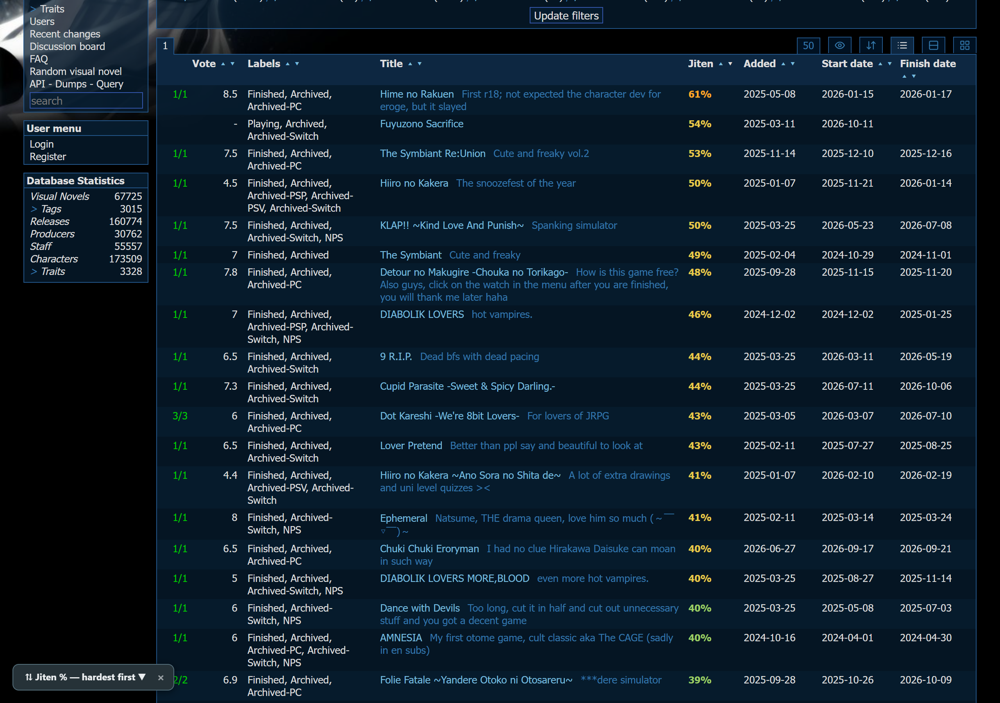
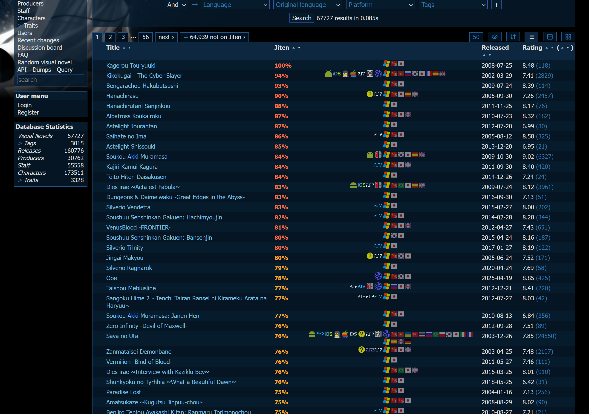
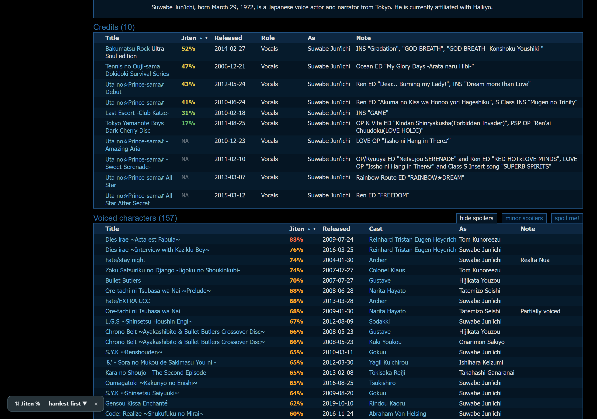
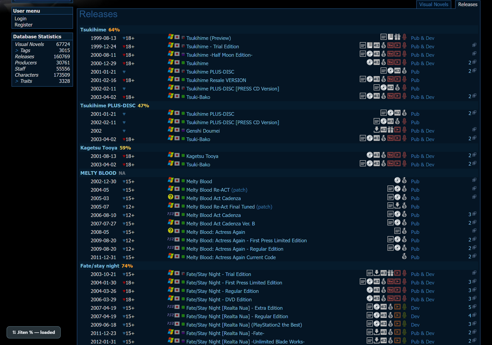
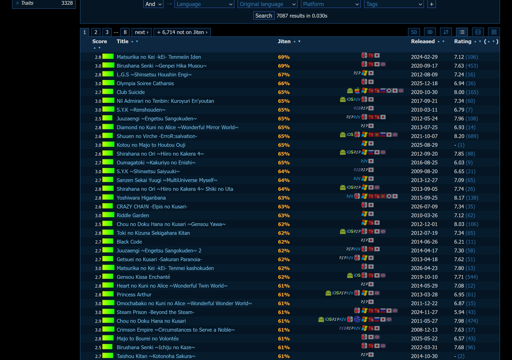
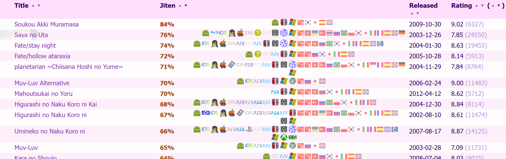
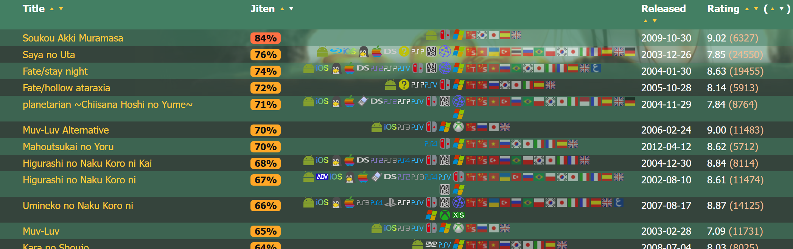
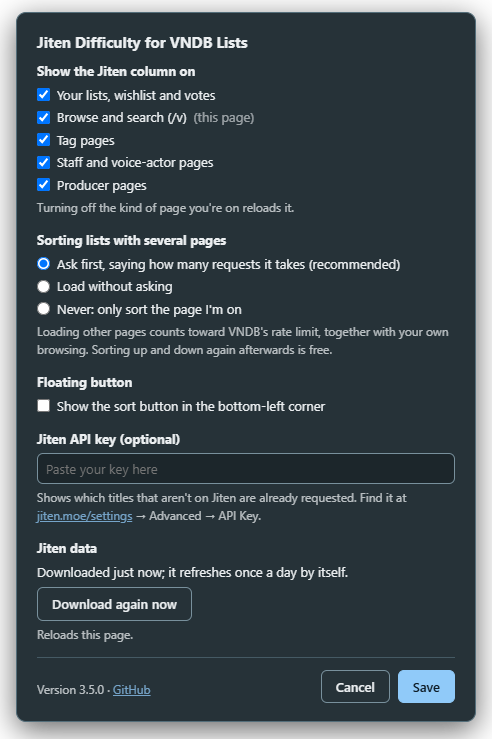

# Jiten Difficulty for VNDB Lists

A small userscript that shows [Jiten](https://jiten.moe) difficulty on [VNDB](https://vndb.org) **list** pages,
so you can see at a glance which visual novels are easy or hard to read in Japanese, and sort by it.

> [!CAUTION]
> ### ⚠️ Please be gentle with VNDB
> VNDB limits how fast one connection can load pages. If you load too much too quickly, VNDB shows
> **"429 - You've been rate-limited!"** and blocks you for a while. VNDB warns that repeated excessive requests
> can lead to a **permanent IP ban**.
>
> Sorting a list with several pages has to load the other pages from VNDB. The script is built to stay well below
> the limit: it **asks you first**, says how many requests it will make, waits 3 seconds between requests, and
> stops at once if VNDB says to slow down. But it shares the limit with everything else you do on VNDB.
>
> - **Use version 3.4.1 or newer.** 3.4.0 loaded big lists far too fast. Update in Tampermonkey.
> - **Don't reload the page and re-sort a big list over and over.** Sorting up and down on the same page is
>   free, but every reload starts over.
> - **Don't sort lots of lists in a row**, in one tab or many, especially while you're also browsing VNDB.
> - **If you see the 429 page, stop.** Don't keep refreshing; wait 10–15 minutes. (When the script itself
>   gets a 429, it also pauses for 10 minutes on its own.)
> - **Want zero risk?** Open **Settings** from the Tampermonkey menu and set *Sorting lists with several pages*
>   to *Never*. Sorting then only sorts the page you're on, and the script never loads anything extra from VNDB.
> - **Tip: use VNDB's 200 results per page view.** A list of up to 200 titles then sorts without loading anything,
>   bigger lists need one request less, and with *Never* each sort still covers 200 titles at once.
>
> This is an unofficial fan script, provided as is (see the [license](LICENSE)). You use it at your own risk.

> ### ⭐ First, install Jiten Everywhere
> This script is only a companion. The real star is **[Jiten Everywhere](https://greasyfork.org/scripts/600904)**
> by nerenar ([GitHub](https://github.com/nerenar/jiten-everywhere)). It brings Jiten's difficulty and deck
> information to media pages across the web, including VNDB's own VN pages.
> If you study Japanese with visual novels, it is highly recommended. Install it first. Then add this script
> if you also want difficulty on whole lists.

## What it does

- Adds a **Jiten** column to VNDB tables that have one row per VN:
  - your list (`/u…/ulist`), wishlist and votes;
  - the `/v` browse and search list;
  - tag pages (`/g…`);
  - staff and voice-actor pages (`/s…`).
- Shows difficulty as a **percentage** (Jiten's 0–5 scale), **colored** from green (beginner) to red (insane).
  Hover over it for the exact score, the difficulty name and the character count. Click it to open the deck on Jiten.
- **Sorts** the list by difficulty with the ▴ ▾ arrows in the *Jiten* header, just like VNDB's other columns
  (▴ easiest first, ▾ hardest first). Titles that aren't on Jiten always go last.
- **Sorts the whole list, not just one page, and keeps the page tabs.** If your list spans several pages,
  the first sort asks you first (saying how many requests it takes), then loads all of them (lists up to 2,000 titles), sorts everything together, and shows the result
  in pages again, with tabs that look like VNDB's and switch instantly. Rows from other pages keep working vote,
  label and date editors.
- **Very long lists** (the `/v` browse list, big tag pages) are sorted by the titles that are on Jiten: VNDB's API
  finds which titles in the list (with your filters) are on Jiten, and each page's rows are loaded from VNDB only
  when you open that page (one request covers four pages). A **+ N not on Jiten ›** tab takes you back to VNDB's
  own order with everything.
- A small spinner and a counter (like `2/6`) next to the *Jiten* header show while anything loads.
  Hover over them for details. On pages without the column (producer pages), a small note in the corner shows the
  first download of the Jiten data (about 10 seconds, once a day).
- There's also an optional floating button in the bottom-left corner that sorts and shows progress.
  It's off by default. Turn it on in **Settings**; its **×** turns it off again.
- **Fits every VNDB skin.** The colors adjust to your skin: light text on dark skins, dark text on light skins,
  and small colored tags on mid-tone skins where neither would be readable.
- Marks titles that aren't on Jiten with a dim **NA**. With a Jiten API key set, titles that are already
  **requested** show **req.** instead.
- On producer pages (`/p…`), VNDB lists each VN with its releases underneath, so the value goes next to the VN title
  and the page isn't reordered.

**Browse list** (`/v`), hardest first:

| Staff / VA page | Producer page |
|---|---|
|  |  |

**Tag page** (Otome Game), the titles on Jiten sorted, in pages:

| Light skin (Moe AI Shit) | Mid-tone skin (Saya no Uta) |
|---|---|
|  |  |

## Install

1. Install a userscript manager such as [Tampermonkey](https://www.tampermonkey.net/) or
   [Violentmonkey](https://violentmonkey.github.io/).
2. Open **[jiten-vndb-list-difficulty.user.js](https://raw.githubusercontent.com/BeannieMoon/jiten-vndb-lists/main/jiten-vndb-list-difficulty.user.js)**
   and confirm the install. Updates come from this repository automatically.
3. Reload any open VNDB tabs.

On Chrome and Edge, Tampermonkey may also need *Allow user scripts* (or *Developer mode*) switched on
in the browser's extension settings.

Installed an older version before this repository existed? It won't update by itself. Open the link above once
and click *Reinstall* / *Update*.

## Settings

On any VNDB page, open the Tampermonkey menu and choose **Settings**:

- **Show the Jiten column on**: turn the script on or off for each kind of page (your lists, browse,
  tag pages, staff pages, producer pages). Where it's off, the script does nothing at all.
- **Sorting lists with several pages**: *Ask first* (the default), *Load without asking*, or *Never*
  (only sort the page you're on).
- **Floating button**: show or hide the sort button in the bottom-left corner.
- **Jiten API key** (optional, see below).
- **Jiten data**: when it was last downloaded, and a button to download it again now.

## Optional: Jiten API key

Everything works without a key. A key only adds the *already requested* check for titles that aren't on Jiten.

1. Copy your key from [jiten.moe/settings](https://jiten.moe/settings) → *Advanced* → *API Key*.
2. Open **Settings** from the Tampermonkey menu on a VNDB page, paste it into *Jiten API key* and click *Save*.

## How it works

The script downloads Jiten's list of visual-novel and game decks that link to VNDB (about 60 small requests).
It keeps that list for 24 hours, so later pages show their values instantly.
After a day it shows the saved list straight away and refreshes it quietly in the background.
To force a refresh, click **Download again now** in Settings.

It only talks to `api.jiten.moe`, and to `vndb.org` / `api.vndb.org` when a sort needs the rest of a list.

**Gentle on both sites.** VNDB rate-limits by IP, counts your own browsing too, and doesn't publish the limit,
so the script stays well below what a person clicking around does:

- Nothing extra is loaded unless you sort a multi-page list **and say yes** to the pop-up, which tells you how many
  requests it will make. *Just this page* sorts only the page you're on. Tick *Remember my choice* and it won't ask
  again; you can change that any time in **Settings** (*Ask first*, *Load without asking* or *Never*).
- Loaded at most once per visit.
- At most one VNDB page every 3 seconds, shared by all your VNDB tabs, 200 rows per request.
  A 1,000-title list is 5 requests; a long list is one request per four pages you actually open.
- VNDB's API (meant for scripts) is used at most once every 1.5 seconds, shared by all your VNDB tabs.
  That's its published limit (200 requests per 5 minutes) and the same pace Jiten Everywhere uses.
- Nothing is retried. If VNDB ever answers *429 Too Many Requests*, the script stops at once and loads nothing
  from VNDB for 10 minutes, in any tab. The ⚠ next to the *Jiten* header says so, and that page is sorted on its own.

On the Jiten side, the catalogue is about 60 requests once a day, downloaded by one tab even if you open several,
with at least 120 ms between requests (Jiten Everywhere's pace). A *429* from Jiten is retried once; a second one
stops Jiten requests for a minute. With an API key, the *already requested* check runs only for titles that come on
screen, each answer is kept for a week, and a rejected key stops the checks.

## Credits

- Difficulty data: [Jiten](https://jiten.moe).
- Companion to [Jiten Everywhere](https://github.com/nerenar/jiten-everywhere) by nerenar.
- Not affiliated with Jiten or VNDB.

## License

[MIT](LICENSE)
